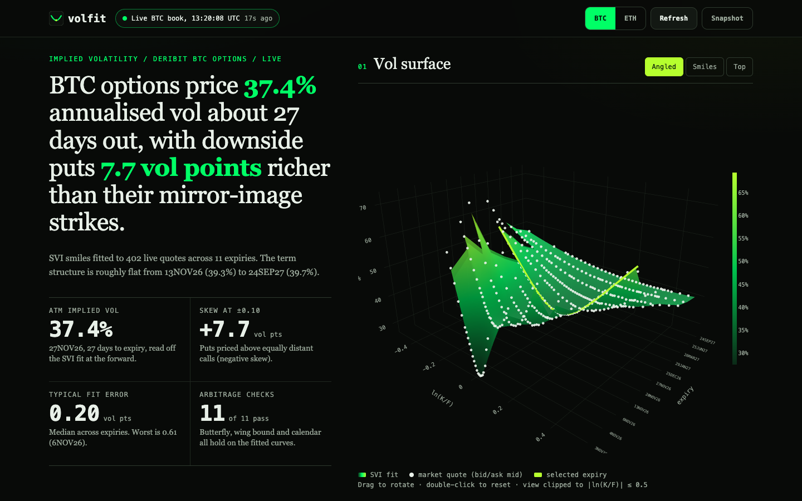

# volfit

**Live demo: https://heykav.github.io/volfit/**

A no-install browser tool that pulls the public Deribit BTC or ETH option book, inverts an implied vol from every usable quote, fits a raw SVI smile per expiry, tests each fit for butterfly and calendar arbitrage, and draws the 3D surface. No server, no API key, nothing leaves your browser except the request to Deribit.



*Real screenshot of the running app on a live Deribit BTC book (1440x900, above the fold). Every figure comes from that fetch. Full-page desktop and mobile shots are in `docs/img/review/`, with the previous design for comparison.*

## What it does

1. Fetches `get_book_summary_by_currency` from Deribit's public API (CORS-enabled, no key).
2. Keeps out-of-the-money options with a two-sided market (and ask <= 3x bid), takes the bid/ask mid, converts coin to USD with Deribit's underlying price.
3. Inverts a Black-76 implied vol on the per-expiry forward Deribit reports (so no interest-rate input).
4. Fits raw SVI, `w(k) = a + b(rho(k-m) + sqrt((k-m)^2 + s^2))`, per expiry. Outer search over `(m, s)`, inner constrained least squares for the rest (the Zeliade split), with bounds on the kink location and width and on Lee's wing bound `b(1+|rho|) <= 4`.
5. Reports per expiry: quote count, ATM IV, **fit RMSE and max error in vol points**, gap to Deribit's own `mark_iv`, Gatheral's butterfly density minimum `g(k)`, the Lee wing check, and a calendar check against the previous expiry.

Every number on the page is traceable: the provenance block shows the exact request URL, the server timestamp, instrument counts and the method. If Deribit cannot be reached, the app switches to a stored snapshot and says so in an amber banner with the snapshot time. You can also force the snapshot.

## Why Deribit and not equity options

Cboe's free delayed-quote JSON (`cdn.cboe.com/api/global/delayed_quotes/options/...`) returns no CORS headers, so a page on GitHub Pages cannot read it. I tested it from a real browser origin and the fetch is blocked. Deribit's public API sends proper CORS headers, needs no key, and crypto options trade around the clock, so there is always a live book.

## Run the tests

```bash
npm install
npm test
```

Needs Node 18 or newer and Google Chrome (the browser tests drive it through `playwright-core`; no browser download). The maths tests need nothing else. The tests cover:

- normal CDF against tabulated values;
- ATM Black-76 against a hand calculation (F=K=100, T=1, vol 20% gives 7.9656);
- put-call parity `C - P = F - K` across strikes, vols and tenors;
- implied-vol round trips and refusal of prices outside no-arbitrage bounds;
- SVI value at the kink by hand, and the butterfly density against a finite-difference version;
- a known-bad raw SVI parameter set (the Gatheral and Jacquier example) is flagged, benign ones pass;
- calendar check and Lee wing check;
- fit recovery of synthetic SVI parameters;
- on the stored real snapshots: our mid-based IV agrees with Deribit's `mark_iv` (median gap under 1 vol point per expiry), and every fitted expiry has RMSE under 1.5 vol points, passes the butterfly scan and stays inside Lee's bound.

Browser tests (real Chrome, Deribit answered from the stored real book so they are deterministic) cover the loading skeleton, the snapshot fallback banner, count-up and surface-build animation, expiry scrubber and chips, 3D drag and double-click reset, reduced-motion behaviour, no layout shift on load, and no horizontal overflow, above-the-fold headline and tap-target size at 375, 768 and 1440 px. A design test checks WCAG AA contrast for the colour tokens and that the stylesheet uses only tokens.

CI runs `npm ci && npm test` on every push and pull request, with read-only permissions.

## Layout

```
docs/            the GitHub Pages site (index.html, app.js, styles.css)
docs/lib/        bs.js (Black-76, IV solver), svi.js (fit and checks), deribit.js (parsing),
                 analyse.js, summary.js (plain-words headline), motion.js (animation helpers)
docs/data/       stored snapshots used as fallback
scripts/         snapshot.mjs refreshes the snapshots; shoot.mjs takes full-page screenshots; og.html is the social preview source
test/            node:test suites (maths, real-data, design, browser)
```

Refresh the fallback snapshots with `npm run snapshot`.

## Limits

- Data is Deribit's public option book at the moment you load the page. It is quotes, not trades, and can be stale or thin in the wings. Near-dated expiries (under 2 days) are not fitted.
- This is crypto, not equity, index or rates data. It is not a Cboe or exchange-listed equity chain.
- The SVI fit is a least-squares fit with bounds. It is not a global arbitrage-free calibration. The butterfly and calendar checks report what holds on the fitted curve over the quoted strike range (plus a small margin), and say nothing about strikes beyond it. Calendar checks compare adjacent expiries only where both have quotes.
- Animation is for orientation only. Frame rate was measured in headless Chrome with a software renderer, so it says nothing about a real GPU.
- The 3D view is clipped to `|ln(K/F)| <= 0.5` for readability, and uses the expiry index on its depth axis, not calendar time.
- The Deribit `mark_iv` comparison is a sanity check on my inversion, not a claim that either is the true vol.
- Nothing here is trading advice or a price you can trade at.

## Data terms

Quotes come from Deribit's public, unauthenticated market-data endpoint, called from your own browser at page load. See [Deribit's API documentation](https://docs.deribit.com/) for its terms and rate limits. The app does not store or redistribute live data; the stored snapshots are small samples kept only so the page still works offline from the source.

## Licence

MIT. See [LICENSE](LICENSE).
